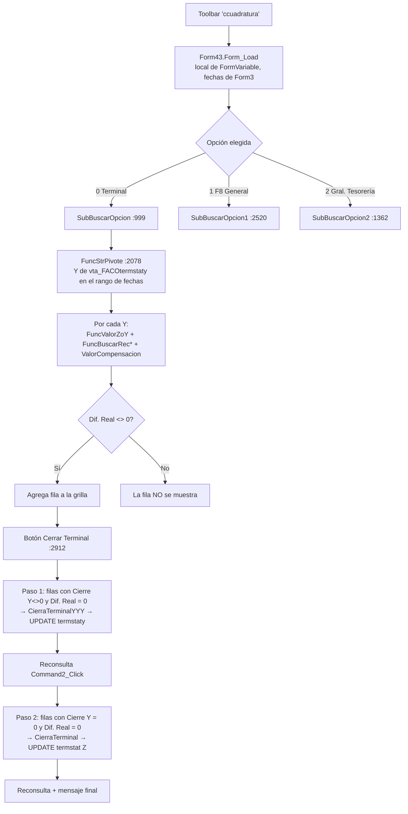

# Consultas de Cuadratura (CC) — Colombia (FACO)

Análisis del formulario `Form43` (`FTEPROD/Form43.frm`, título "Consultas de Cuadratura"), con foco en el botón **Cerrar Terminal** para Falabella Colombia (`Flg_Pais$ = "FACO"`).

Todo lo que sigue sale de leer el código (versión `Gversion = "3.4.9"`). Las referencias `archivo:línea` apuntan al fuente **anterior** al ajuste FSCC-12901, que se conserva en `FTEPROD/Form43.frm.bak_FSCC-12901`.

> **Actualización 06-10-2026 (FSCC-12901, DF-SCC fila 12):** para FACO, `Form43.frm` ya no usa la lógica descrita aquí en el informe "Terminal" ni en "Cerrar Terminal". Ahora muestra todas las cajas, incluidas las de Dif. Real 0, con columnas calculadas por `PKG_F8_FACO_CIERRE_AUTO`, y cierra con `prc_cierre_rango`. El botón aparece solo con el permiso 1515. Esto resuelve B1, B2, B3, B4 y B5 para Colombia. Detalle en `docs/README_FSCC-12901.md` §5c. Este documento se mantiene como análisis del comportamiento anterior y de los demás países. **07-10-2026:** en FACO la grilla y el cierre trabajan **solo con cierres Y** (Colombia no gestiona la Z).

---

## 1. Resumen ejecutivo

- En Colombia la pantalla trabaja **sobre cierres Y** (tabla `vta_FACOtermstaty`), no sobre la Z: cada fila de la grilla es una Y de un terminal.
- La grilla de "Terminal" **solo muestra las Y con Dif. Real ≠ 0** (`Form43.frm:1129`).
- "Cerrar Terminal" **solo cierra las filas con Dif. Real = 0** (`Form43.frm:2946`, `2955`).
- **Consecuencia:** para FACO, el botón "Cerrar Terminal" de esta pantalla **no cierra nada** y siempre termina con el mensaje *"No hay Terminales que Cumplan con el Proceso de Cierre"*. Ver §7 (hallazgos B1 a B3).
- El cierre efectivo en Colombia se hace desde la F8:
  - cada Y, en `Form3Y.CierraTerminal` (`Form3Y.frm:2801`);
  - la Z, en `Form3.CierraTerminal` (`Form3.frm:3439`).
  
  Ver §8.

> La captura que se usó como referencia (local "12-SODIMAC", grilla sin columna "Cierre Y") **no es la vista de Colombia**. Para FACO la grilla tiene la columna "Cierre Y" (`Form43.frm:4870`). Lo que muestra la captura es la vista Chile (`Flg_Pais$ = ""`/`"CHI"`).

---

## 2. Acceso y permisos

| Elemento | Detalle |
|---|---|
| Apertura | Toolbar de `MDIForm1`, clave `"ccuadratura"` → `Form43.Show 1` (`MDIForm1.frm:1696`) |
| Permiso de menú | El de la toolbar (`SubBuscarOpcionMenu`, ver CLAUDE.md §4.2) |
| Permiso del botón Cerrar Terminal | `OpcionPermiteCerrarTerminalCC = 1515` (`Modulo2.bas:253`). **Para FACO no se evalúa** (ver B4) |
| Validación ZZZ | `Btovalidacionzzz = 103` (`Modulo2.bas:215`): si el perfil la tiene, se valida la fórmula de la Z/Y |
| Validación de dólares PRD | `Btovalidacionprddolar = 109` (`Modulo2.bas:216`): solo en el cierre de la Z |

Dependencias al abrir (`Form_Load`, `Form43.frm:3029`):
- `Combo1` (local) se copia de `FormVariable.Combo1` (`:3078`). Para FACO, `FormVariable` normalmente es `Form3Y`.
- Fecha inicio y fecha fin se copian de `Form3.DTPicker1` (`:3083`, `:3086`). Si `Form3` no estaba cargado, VB lo carga de forma implícita.

---

## 3. Interfaz en Colombia

### 3.1 Controles

| Control | Al abrir (FACO) | Después de clic en opción "Terminal" |
|---|---|---|
| Opciones "Terminal" / "F8 General" / "Gral. Tesoreria" | Las 3 visibles | — |
| Combo Local (`Combo1`/`Combo2`) | Visible | Visible |
| Combo Terminal (`Combo3`) | **Oculto** (no entra en ningún `If` de `Form_Load`) | Visible (`OptionInforme_Click`, `:5020`) |
| Botón Cerrar Terminal (`Command4`) | **Oculto** | Visible (`:5022`), sin revisar permiso |
| Fecha Inicio / Fecha Fin | Visibles | Visibles |

El frame "Criterio" viene deshabilitado desde el diseñador. Se habilita al hacer clic en cualquier opción (`:4996`).

### 3.2 Columnas de la grilla (informe "Terminal", `definegrid` caso 0, `:4816`)

| Col | Encabezado | Contenido para FACO |
|---|---|---|
| 0 | Fecha | `ter_fecha` |
| 1 | Local | `ter_local` |
| 2 | Terminal | `ter_terminal` |
| 3 | Cierre Y | `ter_cierrey` (número de la Y) |
| 4 | Dif. de Caja | Σ(recaudado − Y), ver §5 |
| 5 | Compensación | `ValorCompensacion`, ver §5 |
| 6 | Dif. Real | Dif. de Caja − Compensación |
| 7 | Estado | según `termstaty.ter_estado` |
| 8 | Fecha Cierre | **vacía** para FACO (solo se llena en las variantes `SOAR_SOUY`) |

Estados (`:1149` y siguientes):

| `ter_estado` | Texto | Color |
|---|---|---|
| -1 | Pendiente | rojo |
| 0 | Pendiente | amarillo |
| 1 | Cerrado | verde |
| 2 | Impreso | azul |
| 3 | Sin Datos | negro |

---

## 4. Flujo completo



Para FACO, la condición de M y de O nunca se cumple, porque K ya descartó las filas con Dif. Real = 0. Además, la consulta G no devuelve filas con Cierre Y = 0.

### 4.1 Consulta (`Command2_Click`, `:946`)

1. Toma la opción marcada (`VF_NumInforme`).
2. FACO **no** está en la lista de `:976` (SOAR, SOUY, CHI, PER, …), así que usa las rutinas "estándar" `SubBuscarOpcion*`.

### 4.2 SQL principal (`FuncStrPivote`, `:2078`)

Para FACO, `TipoReg = "y"` y `TipoCondi = "Y"`:

```sql
select distinct t.ter_fecha, t.ter_local, t.ter_terminal, t.ter_cierrey, t.ter_estado
from   vta_FACOlibvta l, vta_FACOzzz r, vta_FACOtermstaty t
where  l.vta_tiporeg     = 'Y'
and    t.ter_fecha between :fecha_ini and :fecha_fin
and    l.vta_estado      = 'A'
and    l.vta_techkey     = r.rec_techkey
and    l.vta_fecha_venta = t.ter_fecha
and    l.vta_local       = t.ter_local
and    l.vta_terminal    = t.ter_terminal
and    l.vta_secuencia   = t.ter_cierrey
and    l.vta_local       = :local          -- si el local <> 0
order by 1,2,3
```

- **El combo Terminal no filtra para FACO**: el filtro `l.vta_terminal = …` solo existe para SFCL/ARG (`:2119`). La consulta siempre trae todos los terminales del local.
- Solo aparecen Y que tengan registro en el libro de ventas (`libvta`) y en `zzz`.

---

## 5. Fórmulas (informe "Terminal")

### 5.1 Montos declarados en la Y (`FuncValorZoY`, rama `"FACO"`, `:3296`)

Origen: `vta_FACOlibvta` (tiporeg `'Y'`, `vta_secuencia = Cierre Y`) unida a `vta_FACOzzz`.

| Variable | Columna `zzz` |
|---|---|
| `Zefectivo` | `REC_MEFECTIVO` |
| `Zchequedia` | `REC_MCHKDIA` |
| `Zchequefecha` | `REC_MCHKFECHA` |
| `Ztarjeta` | `rec_mtarj + rec_msodimac` |
| `Zdolares`, `Zeuros`, `Zticketpago`, `Ztarjetacmr` | 0 (fijos) |

### 5.2 Montos recaudados

| Variable | Función | Origen |
|---|---|---|
| `BEfectivo` | `FuncBuscarRecEfectivo("EFE")` `:1640` | `vta_FACOprd`: `prv_montosobre + prv_montodif`, `prv_tiporec in ('F8','DOL')`, `prv_tiposobre='EFE'`, por `prv_cierrey` |
| `BChequeDia` | `FuncBuscarRecEfectivo("CHE")` | ídem con `prv_tiposobre='CHE'` |
| `BDolares` / `BEuros` | `FuncBuscarRecModRec(305/304)` `:1700` | `vta_FACOrecmex` |
| `BChequeFecha` | `FuncBuscarRecCheFecha` `:1818` | `vta_FACOtesor.tes_chefecha`, por `tes_cierrey` |
| `Btarjeta` | `FuncBuscarRecTarj("tarj")` `:1879` | `vta_FACOtarj.vta_monto_inf` (**todos** los códigos de tarjeta), por `vta_cierrey` |
| `BTicker`, `Bcmr` | `FuncBuscarRecTarj("ticket"/"CMR")` | Para FACO filtran `vta_cod_tarj = 9999999`, así que dan 0 (`:1936`) |

### 5.3 Diferencias (`SubBuscarOpcion`, `:1070`–`:1084`)

```
Dif. de Caja = (BEfectivo − Zefectivo) + (BChequeDia − Zchequedia)
             + (BDolares − 0) + (BEuros − 0)
             + (Btarjeta − Ztarjeta) + (BChequeFecha − Zchequefecha)

Compensación = ValorCompensacion(fecha, local, terminal, cierreY)   (:406)

Dif. Real    = Format(Dif. de Caja) − Format(Compensación)          (:1084)
```

`ValorCompensacion` suma las filas de `StrSumCompensado` (`:441`). Para la Y consultada (`mov_cierrey`) incluye:
- `vta_FACOmovdet` con `MOV_REGUL='S'` y `MOV_FECHAREG` no nula, para los tipos `AL, TU, DV, P1, P2, CM, CB, CC, SB, SC, SV, CP, CF, CT, RE, CR, PC, DN, AF, DD, AA, DI, AV, RP, DP, DE, PM`. Para FACO **no** incluye `CA` desde `movdet` (`:738`);
- `vta_FACOdifvend` (diferencias vendedor/cajero, concepto `vta_coddif=1`);
- `vta_FACOmovdet` tipos `DT`, `NC` (dos ramas: `mov_numero <> mov_terminal` y `=`) y `TB`;
- `vta_FACOcartaaviso` tipo `CA` regularizado (`:870`).

---

## 6. Cerrar Terminal

### 6.1 Botón (`Command4_Click`, `:2912`)

Solo actúa si la grilla tiene filas. FACO entra en la rama `ARG/SFCL/FACO/HTPE` (`:2943`):

| Paso | Condición de la fila | Acción |
|---|---|---|
| 1 (`:2945`) | Estado ≠ "Cerrado"/"Pendiente MP", **Cierre Y ≠ 0**, **Dif. Real = 0** | `CierraTerminalYYY(fecha, local, terminal, cierreY)` |
| — | — | `Command2_Click` (reconsulta) |
| 2 (`:2954`) | Estado ≠ "Cerrado"/"Pendiente MP", **Cierre Y = 0**, **Dif. Real = 0** | `CierraTerminal(fecha, local, terminal)` (Z) |
| — | — | `Command2_Click` (reconsulta) |
| Mensaje (`:3014`) | `X > 0` | "Proceso de Cierre Terminal Ejecutado Exitosamente"; si no, "No hay Terminales que Cumplan con el Proceso de Cierre" |

No hay confirmación (los `MsgBox` de confirmación están comentados). Se procesan todas las filas de la grilla en lote.

### 6.2 Cierre de una Y (`CierraTerminalYYY`, `:4558`)

Validaciones en orden. La primera que falla muestra su mensaje y aborta **solo esa Y**:

| # | Validación (FACO) | Mensaje |
|---|---|---|
| 1 | `Func_ValorGestionCheque(…,1)` (`VTA_FACOCHEQUES`, `CHQ_TIPOCHEQUE=1`) = `Func_ValorChequeFecha` (`vta_FACOtesor.tes_chefecha`) (`:4588`; funciones en `Módulo1.bas:5681` y `:5632`) | "Existe diferencia para el concepto cheques a Fecha entre la Gestión de Cheque : (…) versus columna tesoreria : (…), para poder cerrar Y." |
| 2 | Sin `SN` pendiente (`movdet`, `mov_regul` nulo/' '/'N', por `mov_cierrey`) | "Falta regularizar el Sobres No Enviado declarada, o elimine el registro" |
| 3 | Sin `AF` pendiente | "Falta regularizar Atesoramiento Fondo Fijo, …" |
| 4 | Sin `ND` pendiente | "Falta regularizar N/D no digitada declarada, …" |
| 5 | Sin `FN` pendiente | "Falta regularizar Factura no digitada declarada, …" |
| 6 | Sin `NP` pendiente | "Falta regularizar el N/C Publicidad declarada, …" |
| 7 | Sin `BF` pendiente | "Falta regularizar el Billete Falso declarada, …" |
| 8 | Sin `CR` pendiente | "Falta regularizar el Certificado Regalo declarada, …" |
| 9 | Sin `CT` pendiente | "Falta regularizar el carta aviso Tienda declarada, …" |
| 10 | Sin `CA` pendiente (en `vta_FACOcartaaviso`) | "Falta regularizar el carta aviso central declarada, …" |
| 11 | Sin `DP` pendiente | "Falta regularizar la Diferencia Prestadora declarada, …" |
| 12 | Si el perfil tiene permiso 103: `FuncMontoValidaZZZYY(...) = 0` (`:4713`) | "Error, Y descuadrada, favor revisar... diferencia : X" |

Para FACO **no** se validan el cheque al día ni `FuncValidarZoY` (venta vs. medios de pago).

Si todo pasa (`:4742`):

```sql
update vta_FACOtermstaty set ter_estado = '1', ter_cerradopor = :LOGINUSER
where ter_fecha = :fecha and ter_local = :local and ter_terminal = :terminal and ter_cierrey = :cierreY
```

Los conceptos pendientes se buscan con `FuncvalidarConcepto` (`:4760`). Un error de base se trata como "pendiente" (devuelve `True`).

### 6.3 Cierre de la Z (`CierraTerminal`, `:3990`)

| # | Validación (FACO) | Mensaje |
|---|---|---|
| 1–10 | Conceptos SN, AF, ND, FN, NP, BF, CR, CT, CA, DP pendientes **para todo el día** (sin filtro de Y) | Los mismos "Falta regularizar…" |
| 11 | `FuncValidarZSumaY` (`Módulo1.bas:5531`): por cada campo de `vta_paint_z` (`vta_localiz='FACO'`, sin pop-up, `vta_order_z` fuera de 56..76), el monto de la Z (`libvta` F8 + `termstat`) debe ser igual a la suma de las Y (`libvta` Y + `termstaty`) | "En el monto <glosa> Existe diferencia entre el Z y la sumatoria de las Y" (título "Cierre de local") |
| 12 | `FuncValidadCierreyyyy` (`:4449`): todas las Y del terminal y el día deben tener `ter_estado = 1`. Si no hay Y, pasa | **Ninguno**: aborta en silencio (B6) |
| 13 | Permiso 103: `FuncMontoValidaZZZ(...) = 0` | "Error, Z descuadrada, favor revisar... diferencia : X" |
| 14 | Permiso 109: `FuncvalidarDifDolares` | "Error, existen diferencias entre los dólares declarados y los dolares informado por Prosegur…" |

Si todo pasa (`:4175`):

```sql
update vta_FACOtermstat set ter_estado = '1', ter_cerradopor = :LOGINUSER
where ter_fecha = :fecha and ter_local = :local and ter_terminal = :terminal
```

`ter_fechacierre` solo se graba para Chile.

---

## 7. Hallazgos (bugs y riesgos)

| ID | Severidad | Hallazgo | Dónde |
|---|---|---|---|
| **B1** | Alta | La grilla de FACO solo agrega filas con `DiferenciaReal <> 0`. "Cerrar Terminal" solo procesa filas con Dif. Real = 0. **Nunca hay candidatas: el botón no cierra nada en Colombia.** SFCL y HTPE tienen su propia rama que muestra todas las filas; FACO no. | `Form43.frm:1086`, `:1129` vs `:2946`, `:2955` |
| **B2** | Alta | `FuncStrPivote` solo devuelve Y (`termstaty`, `ter_cierrey = vta_secuencia`). El paso 2 (Cierre Y = 0 → cierre de la Z) no tiene filas y nunca se ejecuta desde esta pantalla. | `:2082`, `:2123`, `:2954` |
| **B3** | Media | En la rama ARG/SFCL/FACO/HTPE no se incrementa `X`: aunque se cierre algo, el mensaje final siempre es "No hay Terminales que Cumplan…". La rama `ElseIf Flg_Pais$ = "ARG"` (`:2962`) es inalcanzable, porque ARG ya entra en `:2943`. | `:2943`–`:2961`, `:3014`–`:3018` |
| **B4** | Media (seguridad) | En `OptionInforme_Click`, caso 0, se muestra `Command4` sin evaluar el permiso 1515. Para FACO, cualquier usuario con acceso a la pantalla ve el botón. | `:5016`–`:5023` |
| **B5** | Media | El combo Terminal no filtra para FACO: siempre se consulta y se procesa el local completo. | `:2119` |
| **B6** | Media | Si `FuncValidadCierreyyyy` falla (Y abiertas), `CierraTerminal` aborta **sin mensaje**. `Form3.CierraTerminal` sí avisa "Hay Cierres de Y abiertos". | `:4120` vs `Form3.frm:3636` |
| **B7** | Baja | Con el permiso 103, `FuncMontoValidaZZZYY` recibe `xlocal` en el lugar del número de Y. El mismo bug está en `Form3Y.frm` (pasa `Combo2.Text`). | `:4715` |
| **B8** | Baja | `StrSumCompensado` arma la consulta con `UNION`, que elimina filas idénticas. Dos ramas que devuelvan el mismo `(monto, tipomov)` (p. ej. `DT` con `mov_numero <> terminal` y `=` terminal, con igual suma) se cuentan una sola vez. | `:740`–`:899` |
| **B9** | Baja | Si `ValorCompensacion` falla, devuelve 0 sin mensaje: la Dif. Real se muestra igual a la Dif. de Caja. | `:437` |
| **B10** | Baja | El manejador de error de `SubBuscarOpcion*` libera `BuscarOpcionCompensa` en lugar de `BuscarOpcion`. | `:1186`, `:1356`, `:1497`, `:1634` |
| **B11** | Baja | Informe "F8 General" (FACO): la Dif. Real se escribe en la columna 8, que tiene el encabezado "Fecha Cierre", y la columna 6 "Dif. Real" queda vacía. Viene del cambio "Xintec Sep 2025". | `:2636` vs `:4931` |
| R1 | — | Sin transacciones: el cierre en lote deja algunas Y cerradas y otras no si falla a mitad de camino. | — |

---

## 8. Cómo se cierra realmente la caja en Colombia (F8)

| Etapa | Pantalla / función | Notas |
|---|---|---|
| Cerrar cada Y | `Form3Y.CierraTerminal` (`Form3Y.frm:2801`) | Mismas validaciones que `CierraTerminalYYY`, más: "Terminal ya se Encuentra Cerrado" (`lblEstado.Tag > 0`) y **"Falta Monto por Compensar"** si `Label70` ≠ 0. Pide confirmación "¿Esta seguro de realizar el cierre del Y N° …?". Hace `UPDATE termstaty` de **una** Y (la de `Combo4`). |
| Cerrar la Z | `Form3.CierraTerminal` (`Form3.frm:3439`) | Cheque a fecha (gestión vs. tesorería; exentos los perfiles 8, 10 y 12), conceptos SN/AF/ND/FN/NP/BF/CR/CT/CA/DP del día (PM, DE y VC son solo de Chile), "Falta Monto por Compensar", `FuncValidarZSumaY`, `FuncValidadCierreyyyy` con mensaje "Hay Cierres de Y abiertos", ZZZ (103), dólares (109) y confirmación. Hace `UPDATE termstat`. |

Orden correcto para el usuario:
1. Cuadrar y compensar cada Y hasta que la diferencia quede en 0.
2. Cerrar cada Y.
3. Verificar que la Z sea igual a la suma de las Y.
4. Cerrar la Z.

El detalle completo de cada regla, con su SQL, está en [CierreCaja_FACO_Reglas.md](CierreCaja_FACO_Reglas.md).

La pantalla CC sirve para **ver** qué Y tienen diferencia pendiente, pero en FACO **no sirve para cerrarlas** (B1).

---

## 9. Consultas de diagnóstico (reemplazar `:fecha`, `:local`, `:terminal`)

```sql
-- Estado de las Y del terminal
select ter_cierrey, ter_estado, ter_cerradopor
from   vta_FACOtermstaty
where  ter_fecha = to_date(:fecha,'yyyymmdd') and ter_local = :local and ter_terminal = :terminal
order by ter_cierrey;

-- Estado de la Z
select ter_estado, ter_cerradopor
from   vta_FACOtermstat
where  ter_fecha = to_date(:fecha,'yyyymmdd') and ter_local = :local and ter_terminal = :terminal;

-- Conceptos pendientes de regularizar que bloquean el cierre
select mov_cierrey, mov_tipomov, mov_monto, mov_regul
from   vta_FACOmovdet
where  mov_fecha = to_date(:fecha,'yyyymmdd') and mov_local = :local and mov_terminal = :terminal
and   (mov_regul is null or mov_regul in (' ','N'))
and    mov_tipomov in ('SN','AF','ND','FN','NP','BF','CR','CT','DP');

select mov_cierrey, mov_tipomov, mov_monto, mov_regul
from   vta_FACOcartaaviso
where  mov_fecha = to_date(:fecha,'yyyymmdd') and mov_local = :local and mov_terminal = :terminal
and   (mov_regul is null or mov_regul in (' ','N'))
and    mov_tipomov = 'CA';

-- Cheques a fecha: gestión vs tesorería (deben ser iguales)
select (select nvl(sum(chq_monto),0) from vta_FACOcheques
         where chq_fecha = to_date(:fecha,'yyyymmdd') and chq_local = :local
           and chq_terminal = :terminal and chq_tipocheque = 1) gestion,
       (select nvl(sum(tes_chefecha),0) from vta_FACOtesor
         where tes_fecha = to_date(:fecha,'yyyymmdd') and tes_local = :local
           and tes_terminal = :terminal) tesoreria
from dual;
```

---

## 10. Pendiente de confirmar en la aplicación

Hay que probar con un usuario FACO en el ambiente de test:
1. Que la grilla "Terminal" solo lista Y con diferencia (B1).
2. Que "Cerrar Terminal" responde "No hay Terminales que Cumplan con el Proceso de Cierre" incluso con Y cuadradas (B1/B3).
3. Que el botón aparece aunque el perfil no tenga la opción 1515 (B4).

## Opción TODOS en el combo Local (20-10-2026, FSCC-12901)

Pedido del usuario de negocio. Solo FACO y perfiles 9 (Administrador) y 10 (Super Administrador). Marca `xintec-nruz 20-10-2026`, respaldo `FTEPROD/Form43.frm.bak_FSCC-12901_TODOS`. Sin compilar.

- **`LeeLocales`:** agrega `0-TODOS` como **primera** opción del combo Local, antes del `For` que carga los locales. El local que queda elegido al abrir sigue siendo el de la F8 activa. F8 General elige el primer ítem, que ahora es TODOS, pero no le afecta porque esa consulta ya no filtra por local. La opción `0-TODOS LOS LOCALES` de los perfiles de grupo (1 y 5) no cambia.
- **Consulta:** no cambia. Con el local 0, `SubBuscarOpcion` → `FuncStrPivote` ya no filtraba por local, así que trae las Y de todos los locales FACO del rango.
- **"Cerrar Terminal":** con TODOS, antes de cerrar pregunta (Sí/No, por defecto No). El mensaje dice cuántas cajas con Dif. Real 0 no cerradas hay en la grilla, de cuántos locales y en qué rango de fechas. Con No no cierra nada. No hay tope de rango: lo decide el usuario.
- **Rendimiento:** cada fila hace unas 10 consultas (`FuncValorZoY`, `FuncBuscarRec*`, `ValorCompensacion`). Con muchos locales y días, la consulta puede tardar.
- **Mensaje final de "Cerrar Terminal" (corregido, para cualquier local):** la rama FACO de `Command4_Click` no incrementaba `X` y siempre decía "No hay Terminales que Cumplan con el Proceso de Cierre" (B1/B3). Ahora cuenta las filas "Cerrado" de la grilla antes y después del cierre: si cerró alguna, muestra "Proceso de Cierre Terminal Ejecutado Exitosamente". Una caja que `CierraTerminalYYY` rechaza (con su propio mensaje) no se cuenta.
