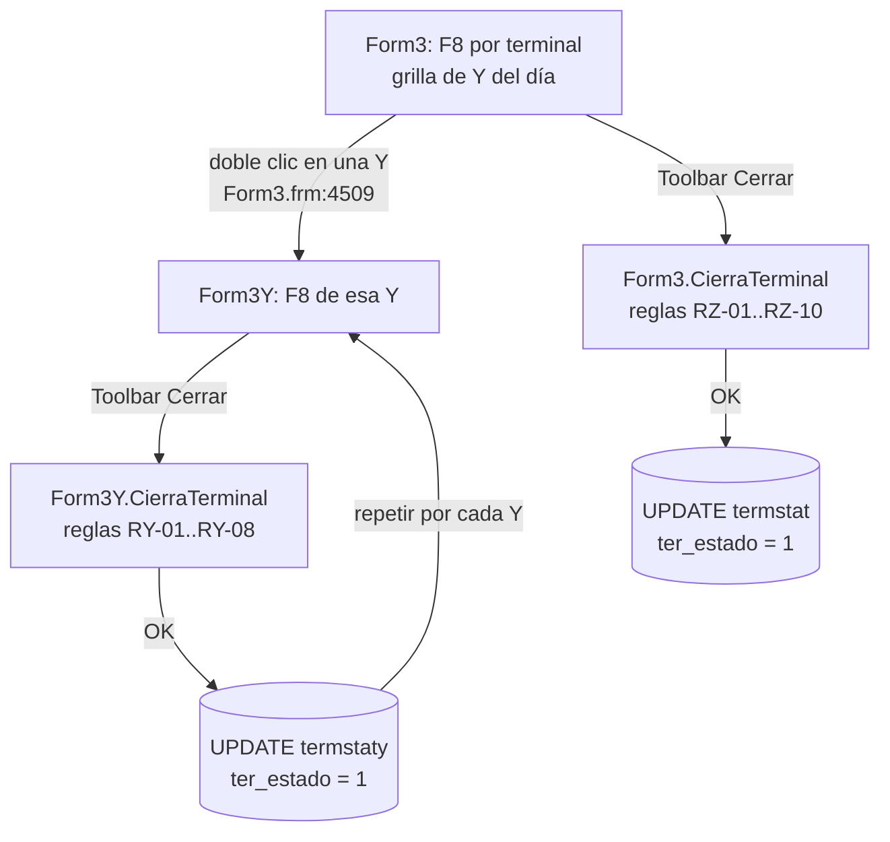

# Cierre de caja en Colombia (FACO): reglas, cálculos y consultas

Este documento reúne todo lo que hace hoy el exe VB6 (`f8a.exe`, versión `3.4.9`) para cerrar un terminal de Falabella Colombia (`Flg_Pais$ = "FACO"`). Sirve como especificación para evaluar si la lógica se lleva a un procedimiento almacenado Oracle.

Todo sale de leer el código. Las referencias `archivo:línea` apuntan a `FTEPROD/`. Para la pantalla de Consultas de Cuadratura (`Form43`), ver [CC_ConsultaCuadratura_FACO.md](CC_ConsultaCuadratura_FACO.md).

> **Actualización 07-10-2026 (FSCC-12901):** Colombia opera **solo con cierre Y**. `Form3Y.CierraTerminal` solo actualiza `vta_FACOtermstaty`. El proceso automático (`PKG_F8_FACO_CIERRE_AUTO`) implementa las reglas RY y **no** las de la Z: §2.2, §4, RZ-03 de §5 y §6.2 quedan como referencia del exe. Ver `FSCC-12901_Analisis.md` §3.14.
>
> **Corrección 15-10-2026:** el exe **sí** puede cerrar la Z de FACO. `Form3.CierraTerminal` no excluye a FACO y tiene condiciones que lo nombran (`:3449`, `:3455`, `:3628`). `Form43` cierra primero las Y y después las Z, y `Form62` (FOSO) exige la Z cerrada. Lo que no se sabe es si negocio la gestiona. La versión `docs/sql/FSCC-12901_PROC_YZ/` implementa §4 (apagada con `CA_CIERRA_Z = N`); ver `README_FSCC-12901.md` §5f. Ojo: en FACO, `Form19` (ingreso manual de la Z) borra las Y del terminal y día.

---

## 1. Alcance y flujo

En Colombia un terminal tiene **varias Y** (cierres parciales del POS) y **una Z** (cierre del día). El cierre se hace en dos niveles:

| Nivel | Pantalla | Función | Tabla que se actualiza |
|---|---|---|---|
| Cada Y | `Form3Y` (F8 con cierres Y) | `Form3Y.CierraTerminal` (`Form3Y.frm:2801`) | `vta_FACOtermstaty` |
| La Z | `Form3` (F8 por terminal) | `Form3.CierraTerminal` (`Form3.frm:3439`) | `vta_FACOtermstat` |

Las dos se disparan con el botón **Cerrar** de la toolbar: `MDIForm1.frm:1606` → `FormVariable.CierraTerminal`. Cuál de las dos se ejecuta depende de la pantalla activa.



Orden obligatorio: **primero todas las Y, después la Z**. La regla RZ-07 exige que todas las Y estén cerradas.

### 1.1 Estados (`ter_estado` en `termstaty` y en `termstat`)

| Valor | Significado en pantalla | ¿Se puede cerrar? |
|---|---|---|
| -1 | Pendiente (rojo) | Sí |
| 0 | Pendiente (amarillo) | Sí |
| 1 | Cerrado | No: "Terminal ya se Encuentra Cerrado" |
| 2 | Impreso | **No**: el control es `ter_estado > 0` (RY-02 / RZ-02) |
| 3 | Sin Datos | **No** (ídem). Si la lectura del estado falla, VB asume 3 (`Form3Y.frm:3160`) |

Al cerrar se graban `ter_estado = '1'` y `ter_cerradopor = <usuario>`. `ter_fechacierre` solo se graba en Chile, no en FACO.

### 1.2 Parámetros que necesitaría un procedimiento

| Parámetro | Origen en VB | Uso |
|---|---|---|
| `p_fecha` | `DTPicker1` | Fecha de venta |
| `p_local` | `Combo2` (código de local) | |
| `p_terminal` | `Combo3` | |
| `p_cierrey` | `Combo4` (= `libvta.vta_secuencia` = `termstaty.ter_cierrey`) | Solo para la Y |
| `p_usuario` | `LOGINUSER` | `ter_cerradopor` |
| `p_perfil` | `PERFILUSER` | Excepciones (RZ-01) y validaciones opcionales (103, 109) |

En el SQL de este documento, las fechas se pasan como `to_date(:p_fecha,'yyyymmdd')` (`VgFormatoFechaWhere`).

---

## 2. Cálculo de la diferencia real

La diferencia real es el corazón del cierre: **tiene que ser 0** (RY-05 / RZ-05).

```
Diferencia de caja (Label50) = Σ (recaudado − declarado en Y/Z)     FormateaDatos
Compensado         (Label60) = ValorCompensacion                     Módulo1.bas:642
Diferencia real    (Label70) = Format(Dif. de caja − Compensado, gFormat)
```

Fórmula para FACO (`Form3Y.frm:2780` y `Form3.frm:3418`):

```
Dif. de caja = (prsefe − totefe)            efectivo: sobres Prosegur − Y/Z
             + (prschd − totchd)            cheque al día: sobres Prosegur − Y/Z
             + totDol                       USD recaudados (recmex 305); la Y/Z no declara USD en FACO
             + (teseuros − toteuros)        siempre 0 en FACO
             + (teschf − totchf)            cheque a fecha: tesorería − Y/Z
             + (tesTarjeta − totTarjeta)    tarjetas: vta_tarj 2000–2999 − (REC_MTARJ + REC_MSODIMAC)
             + (tescupon − totcupon)        0 en FACO
             + (tesTicket − totTicket)      0 en FACO
             + (tesCmr − totCmr)            0 en FACO
```

`Label70` se redondea con `gFormat` (los decimales de `vta_parametros` para FACO) **antes** de compararlo con 0. Un procedimiento debe redondear igual: `round(x, <decimales de gFormat>)`.

### 2.1 Diferencia de la **Y** (`p_cierrey` informado)

Todas las fuentes filtran por la Y.

```sql
-- (a) Declarado en la Y  ->  totefe, totchd, totchf, totTarjeta
--     Form3Y.LeeZ (:1879) + ARMA_QUERY_Z rama FACO (:3922); mapeo de campos en :2161
select nvl(sum(r.rec_mefectivo),0)                          as totefe,
       nvl(sum(r.rec_mchkdia),0)                            as totchd,
       nvl(sum(r.rec_mchkfecha),0)                          as totchf,
       nvl(sum(r.rec_mtarj),0) + nvl(sum(r.rec_msodimac),0) as tottarjeta
from   vta_FACOlibvta l, vta_FACOzzz r
where  l.vta_tiporeg     = 'Y'
and    l.vta_fecha_venta = to_date(:p_fecha,'yyyymmdd')
and    l.vta_local       = :p_local
and    l.vta_terminal    = :p_terminal
and    l.vta_estado      = 'A'
and    l.vta_techkey     = r.rec_techkey
and    l.vta_secuencia   = :p_cierrey;
-- Si no hay fila: VB muestra "No hay Z disponible" y no calcula (LeeZ :1895).

-- (b) Sobres Prosegur  ->  prsefe (EFE), prschd (CHE)          Form3Y.LeeProsegur (:2401)
select nvl(sum(case when p.prv_tiposobre='EFE' then nvl(p.prv_montosobre,0)+nvl(p.prv_montodif,0) end),0) as prsefe,
       nvl(sum(case when p.prv_tiposobre='CHE' then nvl(p.prv_montosobre,0)+nvl(p.prv_montodif,0) end),0) as prschd
from   vta_FACOprd p
where  p.prv_fechavta = to_date(:p_fecha,'yyyymmdd')
and    p.prv_local    = :p_local
and    p.prv_terminal = :p_terminal
and    p.prv_tiporec  = 'F8'
and    p.prv_cierrey  = :p_cierrey;

-- (c) Cheque a fecha en tesorería  ->  teschf                  Form3Y.LeeTes (:2472)
--     OJO: VB NO suma; toma la PRIMERA fila (ver D6).
select nvl(t.tes_chefecha,0) as teschf
from   vta_FACOtesor t
where  t.tes_fecha    = to_date(:p_fecha,'yyyymmdd')
and    t.tes_local    = :p_local
and    t.tes_terminal = :p_terminal
and    t.tes_cierrey  = :p_cierrey;

-- (d) Tarjetas recaudadas  ->  tesTarjeta                      Form3Y.FuncLeeTarjeta (:1611), CTARJ
select nvl(sum(t.vta_monto_inf),0) as testarjeta
from   vta_FACOtarj t
where  t.vta_fecha    = to_date(:p_fecha,'yyyymmdd')
and    t.vta_local    = :p_local
and    t.vta_terminal = :p_terminal
and    t.vta_cierrey  = :p_cierrey
and    t.vta_cod_tarj between 2000 and 2999;

-- (e) Dólares recaudados  ->  tesDol = totDol                  Form3Y.FunConsRecMon (:2614)
select nvl(sum(x.mex_monto),0) as totdol
from   vta_FACOrecmex x
where  x.mex_fecha    = to_date(:p_fecha,'yyyymmdd')
and    x.mex_local    = :p_local
and    x.mex_terminal = :p_terminal
and    x.id_mdareg    = 305
and    x.mex_cierrey  = :p_cierrey;
```

### 2.2 Diferencia de la **Z** (día completo)

> No aplica al proceso de FACO (solo cierre Y, 07-10-2026).

Son las mismas consultas, con estos cambios (`Form3.frm`):

| Fuente | Cambio respecto a la Y | Referencia |
|---|---|---|
| (a) Z | `l.vta_tiporeg = 'F8'`, **sin** filtro `vta_secuencia` | `Form3.LeeZ` `:2345`, rama FACO `:2654`, tarjetas `:2447` |
| (b) Prosegur | Sin `prv_cierrey` | `Form3.LeeProsegur` `:2937` |
| (c) Tesorería | `sum(tes_chefecha)`, sin `tes_cierrey` (aquí sí suma) | `Form3.LeeTes` `:3004` |
| (d) Tarjetas | Sin `vta_cierrey` | `Form3.FuncLeeTarjeta` `:1775` |
| (e) Dólares | Sin `mex_cierrey` | `Form3.FunConsRecMon` `:3163` (rama `Else`) |

### 2.3 Compensado (`ValorCompensacion` → `StrSumCompensado`, `Módulo1.bas:642` / `:2630`)

Con `Gopcion = "T"` (siempre al cerrar), la consulta filtra por **local y terminal**.
- En la **Y** agrega `mov_cierrey = :p_cierrey` (y `ven_cierrey` en `difvend`).
- En la **Z** no filtra por Y.

El compensado es la **suma de todas las filas** que devuelve esta consulta. En VB las ramas se unen con `UNION`, que elimina duplicados (ver D4).

Ramas de la consulta. En todas se filtra `mov_local = :p_local`, `mov_terminal = :p_terminal` y, solo en la Y, `mov_cierrey = :p_cierrey`:

| # | Tipos | Tabla | Monto que suma | Condición |
|---|---|---|---|---|
| 1 | `TC` | `movdet` | Σ(`mov_fecha = :p_fecha`) − Σ(`MOV_FECHAREG = :p_fecha`, `MOV_REGUL='S'`) | La primera suma **no** exige `MOV_REGUL` |
| 2 | `SN` | `movdet` | Σ(`mov_fecha = :p_fecha`, `MOV_REGUL='S'`) − Σ(`MOV_FECHAREG = :p_fecha`, `MOV_REGUL='S'`) | |
| 3 | `ND` | `movdet` | Igual que SN | |
| 4 | `FN` | `movdet` | Igual que SN | |
| 5 | `BF` | `movdet` | Σ(`mov_fecha = :p_fecha`, `MOV_REGUL='S'`) | Sin resta |
| 6 | `NP`, `FT` | `movdet` | Σ(`mov_fecha = :p_fecha`, `MOV_REGUL='S'`) | Sin resta |
| 7 | `TU, DV, P1, P2, CM, CB, CC, SB, SC, SV, CP, CF, CT, RE, CR, PC, DN, AF, DD, AA, DI, AV, RP, DP, CA, DE, PM` | `movdet` ⋈ `concepdif` | Σ`mov_monto`, `group by tipo` | `mov_fecha = :p_fecha`, `MOV_REGUL='S'`, `MOV_FECHAREG is not null`. **Incluye `CA` para FACO** (en la copia de `Form43` no) |
| 8 | `CA` | `cartaaviso` ⋈ `concepdif` | Σ`mov_monto` | `mov_fecha = :p_fecha`, `MOV_REGUL='S'`, `MOV_FECHAREG is not null` |
| 9 | Vendedor-cajero (`concepdif.vta_coddif = 1`) | `difvend` | Σ`ven_monto` | `ven_fecha = :p_fecha` (+ `ven_cierrey` en Y). **Sin** `VEN_REGUL` en FACO (solo Chile lo exige) |
| 10 | `DT`, `NC` | `movdet` | Σ`mov_monto`, `group by tipo` | `mov_fecha = :p_fecha`, `mov_numero <> mov_terminal` |
| 11 | `DT`, `NC` | `movdet` | ídem | `mov_numero = mov_terminal` |
| 12 | `AL` | `movdet` ⋈ `libvta` ⋈ `zzz` | Σ`mov_monto` | `mov_numero = mov_terminal`, `l.vta_estado='A'`, `m.mov_secuencia = l.vta_secuencia`; **Y:** `l.vta_tiporeg='Y'` + `mov_cierrey`; **Z:** `l.vta_tiporeg='F8'` |
| 13 | `TB` | `movdet` | Σ`mov_monto` | `mov_fecha = :p_fecha`, `mov_numero = mov_terminal` |

Consulta lista para usar (versión Y; para la Z, borrar las líneas `--Y` y cambiar `'Y'` por `'F8'` en la rama 12):

```sql
select sum(mov_monto) as compensado from (
  select ( nvl((select sum(m.mov_monto) from vta_FACOmovdet m
                where m.mov_fecha = to_date(:p_fecha,'yyyymmdd') and m.mov_local = :p_local
                  and m.mov_terminal = :p_terminal
                  and m.mov_cierrey = :p_cierrey                                       --Y
                  and m.mov_tipomov = 'TC'),0)
         - nvl((select sum(m.mov_monto) from vta_FACOmovdet m
                where m.mov_fechareg = to_date(:p_fecha,'yyyymmdd') and m.mov_local = :p_local
                  and m.mov_terminal = :p_terminal
                  and m.mov_cierrey = :p_cierrey                                       --Y
                  and m.mov_regul = 'S' and m.mov_tipomov = 'TC'),0) ) mov_monto, d.mov_tipomov
  from vta_FACOconcepdif d where d.mov_tipomov = 'TC'
  union
  -- ramas SN, ND, FN: misma forma que TC, pero la PRIMERA suma también exige mov_regul = 'S'
  select ( nvl((select sum(m.mov_monto) from vta_FACOmovdet m
                where m.mov_fecha = to_date(:p_fecha,'yyyymmdd') and m.mov_local = :p_local
                  and m.mov_terminal = :p_terminal
                  and m.mov_cierrey = :p_cierrey                                       --Y
                  and m.mov_regul = 'S' and m.mov_tipomov = d.mov_tipomov),0)
         - nvl((select sum(m.mov_monto) from vta_FACOmovdet m
                where m.mov_fechareg = to_date(:p_fecha,'yyyymmdd') and m.mov_local = :p_local
                  and m.mov_terminal = :p_terminal
                  and m.mov_cierrey = :p_cierrey                                       --Y
                  and m.mov_regul = 'S' and m.mov_tipomov = d.mov_tipomov),0) ), d.mov_tipomov
  from vta_FACOconcepdif d where d.mov_tipomov in ('SN','ND','FN')
  union
  select nvl((select sum(m.mov_monto) from vta_FACOmovdet m
              where m.mov_fecha = to_date(:p_fecha,'yyyymmdd') and m.mov_local = :p_local
                and m.mov_terminal = :p_terminal
                and m.mov_cierrey = :p_cierrey                                         --Y
                and m.mov_regul = 'S' and m.mov_tipomov = 'BF'),0), d.mov_tipomov
  from vta_FACOconcepdif d where d.mov_tipomov = 'BF'
  union
  -- VB devuelve UNA fila por cada tipo NP/FT que exista en concepdif, cada una con la suma de NP+FT
  select nvl((select sum(m.mov_monto) from vta_FACOmovdet m
              where m.mov_fecha = to_date(:p_fecha,'yyyymmdd') and m.mov_local = :p_local
                and m.mov_terminal = :p_terminal
                and m.mov_cierrey = :p_cierrey                                         --Y
                and m.mov_regul = 'S' and m.mov_tipomov in ('NP','FT')),0), d.mov_tipomov
  from vta_FACOconcepdif d where d.mov_tipomov in ('NP','FT')
  union
  select nvl(sum(m.mov_monto),0), d.mov_tipomov
  from vta_FACOmovdet m, vta_FACOconcepdif d
  where m.mov_fecha = to_date(:p_fecha,'yyyymmdd') and m.mov_local = :p_local and m.mov_terminal = :p_terminal
    and m.mov_cierrey = :p_cierrey                                                     --Y
    and m.mov_regul = 'S' and m.mov_fechareg is not null and m.mov_tipomov = d.mov_tipomov
    and d.mov_tipomov in ('TU','DV','P1','P2','CM','CB','CC','SB','SC','SV','CP','CF','CT','RE','CR','PC',
                          'DN','AF','DD','AA','DI','AV','RP','DP','CA','DE','PM')
  group by d.mov_tipomov
  union
  select nvl(sum(m.mov_monto),0), d.mov_tipomov
  from vta_FACOcartaaviso m, vta_FACOconcepdif d
  where m.mov_fecha = to_date(:p_fecha,'yyyymmdd') and m.mov_local = :p_local and m.mov_terminal = :p_terminal
    and m.mov_cierrey = :p_cierrey                                                     --Y
    and m.mov_regul = 'S' and m.mov_fechareg is not null and m.mov_tipomov = d.mov_tipomov
    and d.mov_tipomov = 'CA'
  group by d.mov_tipomov
  union
  select (select nvl(sum(v.ven_monto),0) from vta_FACOdifvend v
          where v.ven_fecha = to_date(:p_fecha,'yyyymmdd') and v.ven_local = :p_local
            and v.ven_terminal = :p_terminal
            and v.ven_cierrey = :p_cierrey                                             --Y
         ), d.mov_tipomov
  from vta_FACOconcepdif d where d.vta_coddif = 1
  union
  select nvl(sum(m.mov_monto),0), d.mov_tipomov
  from vta_FACOmovdet m, vta_FACOconcepdif d
  where m.mov_fecha = to_date(:p_fecha,'yyyymmdd') and m.mov_numero <> m.mov_terminal
    and m.mov_local = :p_local and m.mov_terminal = :p_terminal
    and m.mov_cierrey = :p_cierrey                                                     --Y
    and m.mov_tipomov = d.mov_tipomov and d.mov_tipomov in ('DT','NC')
  group by d.mov_tipomov
  union
  select nvl(sum(m.mov_monto),0), d.mov_tipomov
  from vta_FACOmovdet m, vta_FACOconcepdif d
  where m.mov_fecha = to_date(:p_fecha,'yyyymmdd') and m.mov_numero = m.mov_terminal
    and m.mov_local = :p_local and m.mov_terminal = :p_terminal
    and m.mov_cierrey = :p_cierrey                                                     --Y
    and m.mov_tipomov = d.mov_tipomov and d.mov_tipomov in ('DT','NC')
  group by d.mov_tipomov
  union
  select nvl(sum(m.mov_monto),0), d.mov_tipomov
  from vta_FACOmovdet m, vta_FACOconcepdif d, vta_FACOlibvta l, vta_FACOzzz z
  where m.mov_fecha = to_date(:p_fecha,'yyyymmdd') and m.mov_numero = m.mov_terminal
    and m.mov_fecha = l.vta_fecha_venta and m.mov_local = l.vta_local and m.mov_terminal = l.vta_terminal
    and l.vta_techkey = z.rec_techkey and l.vta_estado = 'A'
    and m.mov_local = :p_local and m.mov_terminal = :p_terminal
    and m.mov_cierrey = :p_cierrey                                                     --Y
    and l.vta_tiporeg = 'Y'                       -- Z: 'F8'
    and m.mov_secuencia = l.vta_secuencia
    and m.mov_tipomov = d.mov_tipomov and d.mov_tipomov = 'AL'
  group by d.mov_tipomov
  union
  select nvl(sum(m.mov_monto),0), d.mov_tipomov
  from vta_FACOmovdet m, vta_FACOconcepdif d
  where m.mov_fecha = to_date(:p_fecha,'yyyymmdd') and m.mov_numero = m.mov_terminal
    and m.mov_local = :p_local and m.mov_terminal = :p_terminal
    and m.mov_cierrey = :p_cierrey                                                     --Y
    and m.mov_tipomov = d.mov_tipomov and d.mov_tipomov = 'TB'
  group by d.mov_tipomov
);
```

> Para validar que la traducción es exacta, comparar `compensado` con `Label60` de la F8 en varios terminales.
>
> **Ojo con las ramas 6 (NP/FT) y 9 (vendedor-cajero):** VB devuelve una fila **por cada registro de `concepdif`** que cumpla el `where`, y cada fila lleva el monto total. Si `vta_FACOconcepdif` tiene a la vez `NP` y `FT`, o más de un concepto con `vta_coddif = 1`, el monto se **suma más de una vez** (el `UNION` no elimina esas filas porque difieren en `mov_tipomov`). Ver D12.

---

## 3. Reglas para cerrar una **Y** (`Form3Y.CierraTerminal`, `Form3Y.frm:2801`)

Se evalúan **en este orden**. La primera que falla muestra su mensaje y **aborta** el cierre (no se acumulan errores).

| ID | Regla | Bloquea si | Mensaje | Ref. |
|---|---|---|---|---|
| RY-01 | Cheque a fecha: gestión = tesorería | `Format(Σ VTA_FACOCHEQUES.chq_monto [tipo 1]) <> Format(Σ vta_FACOtesor.tes_chefecha)` — **día completo, sin filtro de Y** | "Existe diferencia para el concepto cheques a Fecha entre la Gestión de Cheque : ( X ) versus columna tesoreria : ( Y ) , para poder cerrar Y." | `:2831`; `Módulo1.bas:5632`, `:5681` |
| RY-02 | La Y no está cerrada | `termstaty.ter_estado > 0` (1, 2 o 3; también si no hay fila) | "Terminal ya se Encuentra Cerrado" | `:2847`, `VeEstado :3000` |
| RY-03 | Sin conceptos pendientes de regularizar en la Y | Existe una fila en `vta_FACOmovdet` (o en `vta_FACOcartaaviso` para CA) con `mov_cierrey = :p_cierrey` y `mov_regul` nulo / `' '` / `'N'` / `''`, para cada tipo, en este orden: **SN, AF, ND, FN, NP, BF, CR, CT, CA, DP** | "Falta regularizar <concepto> declarada, o elimine el registro" (ver §5) | `:2854`–`:2921`, `FuncvalidarConcepto :1700` |
| RY-04 | (no aplica a FACO) | Total tarjetas `Label15 <> Label51` solo para ARG/SOAR/SOUY/CHI/CMCL | — | |
| RY-05 | **Diferencia real de la Y = 0** | `CDbl(Label70) <> 0` (§2.1 + §2.3) | "Falta Monto por Compensar" | `:2934` |
| RY-06 | Validación ZZZ de la Y | Solo si el perfil tiene la opción **103** (`Btovalidacionzzz`): `FuncMontoValidaZZZYY <> 0` (§6.1) | "Error, Y descuadrada, favor revisar... diferencia : X" | `:2955` (**ver D1**) |
| RY-07 | Confirmación | El usuario responde "No" | "¿Esta seguro de realizar el cierre del Y N° : n, para este Terminal ?" | `:2965` |
| RY-08 | Cierre | — | — | `:2983` |

```sql
-- RY-08
update vta_FACOtermstaty
set    ter_estado = '1', ter_cerradopor = :p_usuario
where  ter_fecha = to_date(:p_fecha,'yyyymmdd') and ter_local = :p_local
and    ter_terminal = :p_terminal and ter_cierrey = :p_cierrey;
```

Para FACO **no** se validan: cheque al día (gestión contra recaudación), `FuncValidarZoY` (venta contra medios de pago) ni `ValidarCuadraturaZY` (Perú). Están excluidos explícitamente con `Flg_Pais$ <> "FACO"`.

---

## 4. Reglas para cerrar la **Z** (`Form3.CierraTerminal`, `Form3.frm:3439`)

> **No aplica a FACO** desde el 07-10-2026: Colombia opera solo con cierre Y y el proceso no cierra la Z. Se conserva como referencia del exe.

| ID | Regla | Bloquea si | Mensaje | Ref. |
|---|---|---|---|---|
| RZ-01 | Cheque a fecha: gestión = tesorería (día) | Igual que RY-01. **Exentos los perfiles 8, 10 y 12** (`PERFIL_USER_OCHO`, `_DIEZ`, `_NEWADMIN`) | Igual que RY-01 (dice "para poder cerrar Y." aunque se esté cerrando la Z) | `:3459`–`:3460` |
| RZ-02 | La Z no está cerrada | `termstat.ter_estado > 0` | "Terminal ya se Encuentra Cerrado" | `:3493` |
| RZ-03 | Sin conceptos pendientes **en todo el día** (sin filtro de Y) | Igual que RY-03, sin `mov_cierrey`: **SN, AF, ND, FN, NP, BF, CR, CT, CA, DP**. VC, DE y PM aplican solo a Chile | "Falta regularizar …" | `:3500`–`:3588`, `FuncvalidarConcepto :1872` |
| RZ-04 | (no aplica a FACO) | Total tarjetas solo para ARG/SOAR/SOUY/CHI/CMCL | — | |
| RZ-05 | **Diferencia real de la Z = 0** | `CDbl(Label70) <> 0` (§2.2 + §2.3 sin Y) | "Falta Monto por Compensar" | `:3619` |
| RZ-06 | Z = suma de las Y | Para cada campo de `vta_paint_z` (`vta_localiz='FACO'`, sin pop-up, `vta_order_z` fuera de 56..76): Σ campo en `libvta` F8 + `termstat` ≠ Σ campo en `libvta` Y + `termstaty` | "En el monto <glosa> Existe diferencia entre el Z y la sumatoria de las Y" | `:3630`; `Módulo1.bas:5531` |
| RZ-07 | Todas las Y cerradas | Alguna Y del terminal y día con `ter_estado` -1, 0, 2 o 3. **Si no hay ninguna Y, avisa pero deja seguir** (ver D2) | "No se puede cerrar el terminal, Porque se encuentra con estado Pendiente / Impreso / Sin dato, el N° de cierre de Y : n del terminal : t" y además "Hay Cierres de Y abiertos" | `:3634`; `FuncValidadCierreyyyy :2153` |
| RZ-08 | Validación ZZZ de la Z | Solo con la opción **103**: `FuncMontoValidaZZZ <> 0` (§6.1, `tiporeg 'F8'`) | "Error, Z descuadrada, favor revisar... diferencia : X" | `:3647` |
| RZ-09 | Dólares declarados = dólares Prosegur | Solo con la opción **109**: `Σ(−recmex.mex_cantidad [305]) + Σ(prd DOL montosobre+montodif) <> 0` | "Error, existen diferencias entre los dólares declarados y los dolares informado por Prosegur , favor revisar... diferencia" | `:3667`; `FuncvalidarDifDolares :1966` |
| RZ-10 | Confirmación + cierre | El usuario responde "No" | "¿Esta seguro de realizar el cierre para este Terminal?" | `:3677`, `:3693` |

```sql
-- RZ-07: estado de las Y
select l.vta_secuencia, t.ter_estado
from   vta_FACOlibvta l, vta_FACOzzz r, vta_FACOtermstaty t
where  l.vta_tiporeg = 'Y' and l.vta_fecha_venta = to_date(:p_fecha,'yyyymmdd')
and    l.vta_local = :p_local and l.vta_terminal = :p_terminal and l.vta_estado = 'A'
and    l.vta_techkey = r.rec_techkey
and    l.vta_fecha_venta = t.ter_fecha and l.vta_local = t.ter_local
and    l.vta_terminal = t.ter_terminal and l.vta_secuencia = t.ter_cierrey;
-- bloquea si alguna fila tiene ter_estado <> 1

-- RZ-09: dólares
select nvl(sum(a.monto),0) from (
  select sum(nvl(r.mex_cantidad,0)*-1) monto, count(*)*-1 numero, 'RECMEX' origen
  from vta_FACOrecmex r
  where r.mex_fecha = to_date(:p_fecha,'yyyymmdd') and r.mex_local = :p_local
    and r.id_mdareg = 305 and r.mex_terminal = :p_terminal
  union
  select sum(p.prv_montosobre)+sum(p.prv_montodif), count(*), 'PRD'
  from vta_FACOprd p
  where p.prv_fechavta = to_date(:p_fecha,'yyyymmdd') and p.prv_tiporec = 'DOL'
    and p.prv_local = :p_local and p.prv_terminal = :p_terminal
) a;   -- bloquea si <> 0

-- RZ-10
update vta_FACOtermstat
set    ter_estado = '1', ter_cerradopor = :p_usuario
where  ter_fecha = to_date(:p_fecha,'yyyymmdd') and ter_local = :p_local and ter_terminal = :p_terminal;
```

---

## 5. Conceptos pendientes (RY-03 / RZ-03)

Consulta (`FuncvalidarConcepto`). Para `CA` se usa la tabla `cartaaviso`; para el resto, `movdet`.

```sql
select 1
from   vta_FACOmovdet            -- vta_FACOcartaaviso si :p_tipo = 'CA'
where  mov_fecha    = to_date(:p_fecha,'yyyymmdd')
and    mov_local    = :p_local
and    mov_terminal = :p_terminal
and   (mov_regul is null or mov_regul in (' ','N'))   -- VB también compara con '' (en Oracle '' = null)
and    mov_tipomov  = :p_tipo
and    mov_cierrey  = :p_cierrey;   -- solo en el cierre de la Y
-- si devuelve filas -> bloquea.  Si la consulta falla -> VB también bloquea (D3)
```

| Tipo | Mensaje |
|---|---|
| SN | Falta regularizar el Sobres No Enviado declarada, o elimine el registro |
| AF | Falta regularizar Atesoramiento Fondo Fijo, o elimine el registro |
| ND | Falta regularizar N/D no digitada declarada, o elimine el registro |
| FN | Falta regularizar Factura no digitada declarada, o elimine el registro |
| NP | Falta regularizar el N/C Publicidad declarada, o elimine el registro |
| BF | Falta regularizar el Billete Falso declarada, o elimine el registro |
| CR | Falta regularizar el Certificado Regalo declarada, o elimine el registro |
| CT | Falta regularizar el carta aviso Tienda declarada, o elimine el registro |
| CA | Falta regularizar el carta aviso central declarada, o elimine el registro |
| DP | Falta regularizar la Diferencia Prestadora declarada, o elimine el registro |

---

## 6. Validaciones dinámicas (dependen de `vta_paint_z`)

### 6.1 ZZZ (opción 103): `FuncMontoValidaZZZ` / `FuncMontoValidaZZZYY` (`Módulo1.bas:4105`, `:4160`)

Para cada grupo `k = 1..7`, la fórmula se arma con las columnas de `vta_paint_z` (`StrCamposValidarZZZ`, `:4053`):

```sql
select z.vta_cmp_asoc, z.vta_signo, z.vta_order_z
from   vta_paint_z z
where  z.vta_localiz = 'FACO' and z.vta_validadorzzz = :k
order by z.vta_order_z;
```

`Funcion_k` es la suma con signo de esas columnas sobre `libvta ⋈ zzz` (`tiporeg 'F8'` para la Z; `'Y'` + `vta_secuencia` para la Y). Grupos: 1 venta, 2 recaudación, 3 recaudación 3, 4 otras operaciones, 5 envío de dinero, 6 activación gift, 7 formas de pago.

```
Diferencia ZZZ = F7 − F6 − F5 − F4 − F3 − F2 − F1     (debe ser 0)
```

Si la consulta falla, la función devuelve "0": la validación pasa.

### 6.2 Z = ΣY (RZ-06): `FuncValidarZSumaY` (`Módulo1.bas:5531`)

> No aplica a FACO (solo cierre Y, 07-10-2026).

```sql
-- campos a comparar
select z.vtaglosa_z, z.vta_cmp_asoc, z.vta_order_z
from   vta_paint_z z
where  z.vta_localiz = 'FACO' and nvl(z.vta_pop_up,0) = 0
order by z.vta_order_z;
-- para cada campo con vta_order_z < 56 o > 76:
--   Z  = sum(campo) en libvta(F8) ⋈ zzz ⋈ termstat  (fecha, local, terminal, estado 'A')
--   ΣY = sum(campo) en libvta(Y)  ⋈ zzz ⋈ termstaty (… y vta_secuencia = ter_cierrey)
--   bloquea en la primera diferencia distinta de 0
```

En un procedimiento, esto requiere **SQL dinámico** (`EXECUTE IMMEDIATE` / `DBMS_SQL`), o bien fijar la lista de columnas de FACO en el código (más simple, pero hay que mantenerla al día si cambia `vta_paint_z`).

---

## 7. Diferencias entre implementaciones (fuente de verdad)

El cierre se implementa en **tres lugares** que no comparten código: `Form3Y` (Y), `Form3` (Z) y `Form43` (pantalla CC, cierre masivo). Diferencias para FACO:

| Aspecto | F8 (`Form3`/`Form3Y`) | CC (`Form43`) |
|---|---|---|
| Sobres Prosegur | `prv_tiporec = 'F8'` | `'F8'` **o** `'DOL'` |
| Tarjetas | Códigos 2000–2999 | Todas (sin filtro de código) |
| USD en la diferencia | `+ totDol` | `+ (BDolares − 0)` (equivalente) |
| Euros | 0 | `recmex 304` |
| "Falta Monto por Compensar" | Sí (RY-05 / RZ-05) | No (filtra la grilla) |
| `StrSumCompensado` | `Módulo1.bas:2630` (incluye `CA` en `movdet`) | Copia privada `Form43.frm:441` (sin `CA` en `movdet`) |
| Confirmación | Sí | No |
| Perfiles exentos de RZ-01 | 8, 10, 12 | No hay excepción |

**Recomendación:** tomar como fuente de verdad la F8 (`Form3Y` + `Form3` + `Módulo1`). Es la que usan los cajeros y la que el documento CC muestra que funciona; la ruta de `Form43` en FACO no llega a cerrar.

---

## 8. Comportamientos a decidir antes de replicar (mantener o corregir)

| ID | Hoy | Efecto | Recomendación |
|---|---|---|---|
| D1 | RY-06 llama a `FuncMontoValidaZZZYY(fecha, local, terminal, **local**)` (`Form3Y.frm:2955`). Filtra `vta_secuencia = <número de local>`, no encuentra filas y devuelve 0 | La validación ZZZ de la Y **no valida nada** en FACO | Corregir (usar `p_cierrey`) solo con acuerdo de negocio: activarla puede bloquear cierres que hoy pasan |
| D2 | RZ-07 sin filas de Y: muestra un aviso y **deja cerrar** la Z | Un terminal sin Y en `libvta` puede cerrar la Z | Decidir si un terminal sin Y debe bloquear |
| D3 | Un error de base en `FuncvalidarConcepto` se trata como "pendiente" (bloquea). En `FuncMontoValidaZZZ*` se trata como 0 (pasa). En `VeEstado`, como estado 3 (bloquea) | Criterio inconsistente | En el SP: cualquier error → `ROLLBACK` y error explícito |
| D4 | `StrSumCompensado` y `FuncvalidarDifDolares` usan `UNION`: dos filas idénticas (mismo monto y tipo, o mismo monto/número/origen) se cuentan una vez | Riesgo bajo, pero real, de compensado mal calculado | Replicar `UNION` para cuadrar con el exe y, después, decidir `UNION ALL` |
| D5 | Sin transacción ni bloqueo: dos usuarios pueden cerrar o modificar el mismo terminal a la vez; las validaciones leen datos que pueden cambiar antes del `UPDATE` | Cierres con datos desactualizados | SP con `SELECT … FOR UPDATE` sobre la fila de `termstat[y]` y validación + `UPDATE` en la misma transacción |
| D6 | `Form3Y.LeeTes` no suma: toma la **primera** fila de `vta_FACOtesor` para la Y | Si hay más de una fila por Y, la diferencia sale mal | Confirmar en la base si puede haber más de una fila; en el SP usar `sum()` |
| D7 | RY-01 y RZ-01 comparan el cheque a fecha **de todo el día** también al cerrar una Y | Una Y puede quedar bloqueada por cheques de otra Y | Decidir si se filtra por Y |
| D8 | RY-01/RZ-01 comparan **textos formateados** (`Format(x, gFormat)`) | Equivale a comparar redondeado | En el SP: `round(a,n) <> round(b,n)` |
| D9 | `Label70` se redondea con `gFormat` antes de comparar con 0 | Diferencias menores al último decimal pasan | Replicar con `round(…, n)` |
| D10 | Mensaje de RZ-01 dice "para poder cerrar Y." | Cosmético | Ajustar el texto en el SP |
| D11 | Estados 2 (Impreso) y 3 (Sin Datos) bloquean el cierre como si estuviera cerrado | Para cerrar una Y impresa hay que reabrirla antes (`Form20`) | Confirmar con negocio |
| D12 | Ramas NP/FT y vendedor-cajero de `StrSumCompensado`: una fila por registro de `concepdif` (§2.3) | Posible doble conteo del compensado | **Descartado en test (06-10-2026):** `vta_FACOconcepdif` tiene un solo `NP` (sin `FT`) y un solo `coddif = 1` (`VC`). Volver a verificarlo en producción |

---

## 9. Propuesta de diseño para un procedimiento almacenado

### 9.1 Qué queda en VB y qué pasa a la base

| Queda en VB | Pasa a la base (paquete) |
|---|---|
| Elegir fecha, local, terminal e Y | Cálculo de la diferencia real (§2) |
| Pregunta de confirmación (RY-07 / RZ-10) | Todas las reglas RY-01..06 y RZ-01..09 |
| Mostrar el mensaje que devuelve el SP | Bloqueo, `UPDATE` y `COMMIT`/`ROLLBACK` |
| Refrescar la F8 | Lectura de permisos (`vta_FACOrelpermen`, opciones 103 y 109) |

### 9.2 Interfaz sugerida (`PKG_F8_CIERRE_FACO`, nombre a definir)

```sql
create or replace package pkg_f8_cierre_faco as
  -- diferencia real (Label70). p_cierrey null => Z
  function fn_dif_real (p_fecha date, p_local number, p_terminal number,
                        p_cierrey number default null) return number;

  -- valida sin grabar; devuelve 0 = OK, o el código de la primera regla que falla
  procedure pr_validar (p_fecha date, p_local number, p_terminal number, p_cierrey number,
                        p_perfil number, o_codigo out varchar2, o_mensaje out varchar2);

  procedure pr_cerrar_y (p_fecha date, p_local number, p_terminal number, p_cierrey number,
                         p_usuario varchar2, p_perfil number,
                         o_codigo out varchar2, o_mensaje out varchar2);

  procedure pr_cerrar_z (p_fecha date, p_local number, p_terminal number,
                         p_usuario varchar2, p_perfil number,
                         o_codigo out varchar2, o_mensaje out varchar2);
end;
```

Esqueleto de `pr_cerrar_y` (orientativo):

```sql
procedure pr_cerrar_y (...) is
  v_estado vta_FACOtermstaty.ter_estado%type;
begin
  -- D5: bloquear la Y
  select ter_estado into v_estado
  from   vta_FACOtermstaty
  where  ter_fecha = p_fecha and ter_local = p_local
  and    ter_terminal = p_terminal and ter_cierrey = p_cierrey
  for update nowait;

  pr_validar(p_fecha, p_local, p_terminal, p_cierrey, p_perfil, o_codigo, o_mensaje);
  if o_codigo <> '0' then rollback; return; end if;

  update vta_FACOtermstaty
  set    ter_estado = '1', ter_cerradopor = p_usuario
  where  ter_fecha = p_fecha and ter_local = p_local
  and    ter_terminal = p_terminal and ter_cierrey = p_cierrey;
  commit;
exception
  when no_data_found then rollback; o_codigo := 'RY-02'; o_mensaje := 'Terminal ya se Encuentra Cerrado';
  when others        then rollback; o_codigo := 'ERR';   o_mensaje := sqlerrm;
end;
```

`pr_validar` aplica las reglas en el **mismo orden** que §3/§4 y devuelve la primera que falla, con el mismo mensaje. Así el exe puede mostrar exactamente el mismo texto. Opcionalmente, puede devolver la lista completa de reglas que fallan; eso conviene para una pantalla de diagnóstico.

### 9.3 Puntos de atención

- **Prefijo de tablas:** el paquete es solo para FACO (`vta_FACO*`). Si en el futuro se reutiliza para otro país, habrá que usar SQL dinámico por prefijo, como hace VB.
- **`vta_paint_z`:** RZ-06 y la ZZZ dependen de su configuración. Se necesita SQL dinámico o una lista fija de campos.
- **Permisos 103 y 109:**
  ```sql
  select 1 from vta_FACOrelpermen p, vta_FACOmenu m
  where p.mnu_codigo = m.mnu_codigo and p.per_codigo = :p_perfil
    and p.mnu_codigo = :opcion and p.rel_estado < 0
  ```
- **Convivencia:** mientras el exe siga cerrando por su cuenta, el SP y el exe tienen que dar el mismo resultado. Validar con la matriz de §10 antes de cambiar el botón.

---

## 10. Matriz de casos de prueba (comparar SP contra exe)

| # | Escenario | Esperado |
|---|---|---|
| 1 | Y cuadrada, sin pendientes, estado 0 | Cierra la Y |
| 2 | Y con estado 1 / 2 / 3 | RY-02 |
| 3 | Gestión de cheques tipo 1 ≠ `tes_chefecha` del día | RY-01 / RZ-01 |
| 4 | Ídem con perfil 8, 10 o 12 (cierre de Z) | La Z no se bloquea por RZ-01 |
| 5 | Un `SN` sin regularizar en la Y (uno por cada tipo de §5) | RY-03 con el mensaje del tipo |
| 6 | Un `SN` sin regularizar en otra Y del mismo día | La Y actual cierra; la Z se bloquea (RZ-03) |
| 7 | Sobre EFE de Prosegur 1 peso distinto de `REC_MEFECTIVO` | RY-05 |
| 8 | Caso 7 + compensación regularizada por 1 peso | Cierra |
| 9 | Diferencia menor que la precisión de `gFormat` | Cierra (D9) |
| 10 | Tarjeta con código fuera de 2000–2999 | No afecta la diferencia |
| 11 | USD en `recmex` sin compensación | RY-05 (USD suma como sobrante) |
| 12 | Perfil con 103 y Y descuadrada en fórmula ZZZ | Hoy cierra (D1) |
| 13 | Z con una Y abierta | RZ-07 |
| 14 | Z sin ninguna Y en `libvta` | Hoy avisa y sigue (D2) |
| 15 | Z ≠ ΣY en un campo de `vta_paint_z` | RZ-06 con la glosa |
| 16 | Perfil con 109 y USD declarados ≠ Prosegur DOL | RZ-09 |
| 17 | Dos usuarios cerrando la misma Y a la vez | SP: uno espera o falla por `nowait`; exe: ambos "cierran" |

---

## 11. Archivos fuente consultados

- `Form3Y.frm`: `CierraTerminal` 2801, `FormateaDatos` 2704, `LeeZ` 1879, `LeeProsegur` 2401, `LeeRetiros` 2319, `LeeTes` 2472, `FunConsRecMon` 2614, `FuncLeeTarjeta` 1611, `FuncvalidarConcepto` 1700, `VeEstado` 3000, `ProcesoConsulta` 3524, `ARMA_QUERY_Z` 3842.
- `Form3.frm`: `CierraTerminal` 3439, `FormateaDatos` 3337, `LeeZ` 2345, `LeeProsegur` 2937, `LeeTes` 3004, `FunConsRecMon` 3163, `FuncLeeTarjeta` 1775, `FuncvalidarConcepto` 1872, `FuncvalidarDifDolares` 1966, `FuncValidadCierreyyyy` 2153, `ProcesoConsulta` 4403, `Grid2_DblClick` 4509.
- `Módulo1.bas`: `ValorCompensacion` 642, `FuncBuscarOpcionCompensa` 1111, `StrSumCompensado` 2630, `StrCamposValidarZZZ` 4053, `FuncValidaZZZ` 4064, `FuncMontoValidaZZZ` 4105, `FuncMontoValidaZZZYY` 4160, `FuncValidarZSumaY` 5531, `Func_ValorChequeFecha` 5632, `Func_ValorGestionCheque` 5681; constantes de perfiles 172–177.
- `Modulo2.bas`: `llena_struct_z` 1028; constantes 103 / 109 / 1515 en 215, 216, 253.
- `MDIForm1.frm`: toolbar `"Cerrar"` 1606.
